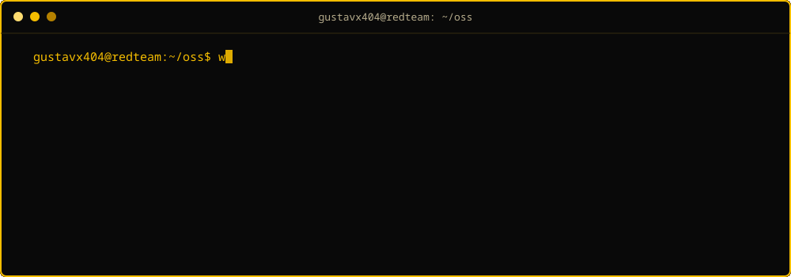
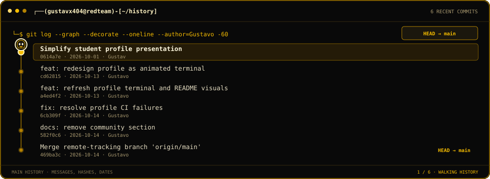

## Community

Leave a note in the [visitor wall](https://github.com/Gustavx404/Gustavx404/issues/new?template=visitor-message.yml) or [suggest a project](https://github.com/Gustavx404/Gustavx404/issues/new?template=project-vote.yml).

<!-- COMMUNITY_START -->
### Visitor Wall

_No messages yet. Leave the first note using the visitor form above._

### What should I build next?

React with 👍 on a proposal to vote.

_No proposals yet. Suggest the first project using the form above._
<!-- COMMUNITY_END -->
