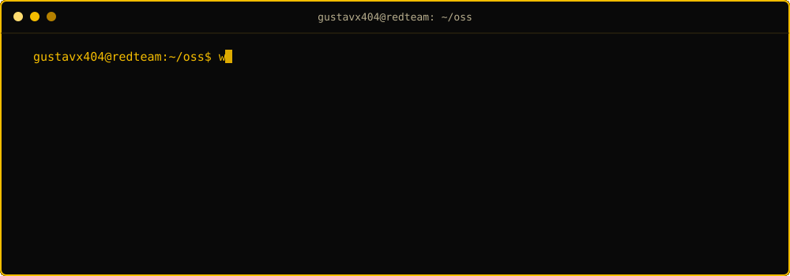
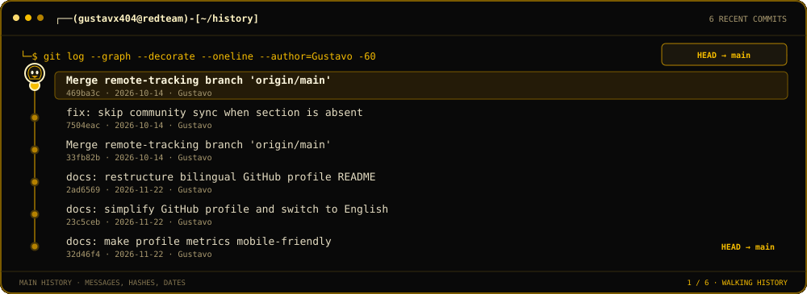

[**PT-BR**](README.pt-BR.md) · **EN**

## `$ whoami`

I'm **Gustavx404**, a Red Team operator and Linux user since 2017. My projects bring together web security, AI, Linux tooling, and self-hosted infrastructure. I'm open to work in cybersecurity.

## `$ ls ~/projects`

### Security and lab

| Repository | What you'll find |
| --- | --- |
| [ctf-vault](https://github.com/gustavx404/ctf-vault) | Knowledge base for CTF practice and offensive security studies. |
| [redteam-ai](https://github.com/gustavx404/redteam-ai) | Local AI lab for Red Team research. |
| [homelab](https://github.com/gustavx404/homelab) | Self-hosted infrastructure with Docker Compose, Suricata, and CrowdSec. |

### Linux and open source

| Repository | What you'll find |
| --- | --- |
| [backup-omarchy](https://github.com/gustavx404/backup-omarchy) | Omarchy backup and sync with a Quickshell dashboard, rclone, and systemd scheduling. |
| [yubikey-omarchy](https://github.com/gustavx404/yubikey-omarchy) | Quickshell widget for YubiKey TOTP and HOTP codes. |
| [.dotfiles](https://github.com/gustavx404/.dotfiles) | CachyOS and Arch configuration for Fish, Kitty, Starship, and other tools with the Ayu Dark theme. |

### Applications and hardware

| Repository | What you'll find |
| --- | --- |
| [atlas-launcher](https://github.com/gustavx404/atlas-launcher) | Lightweight, open-source Java launcher for Android TV 11+ on ARMv7. |
| [video-upload](https://github.com/gustavx404/video-upload) | Video upload app with login, built with FastAPI, Jinja2, and SQLite. |
| [Portao_esp32](https://github.com/gustavx404/Portao_esp32) | ESP32 gate controller with MQTT discovery for Home Assistant. |

[Browse all public repositories ↗](https://github.com/gustavx404?tab=repositories)

## `$ git log --oneline`

