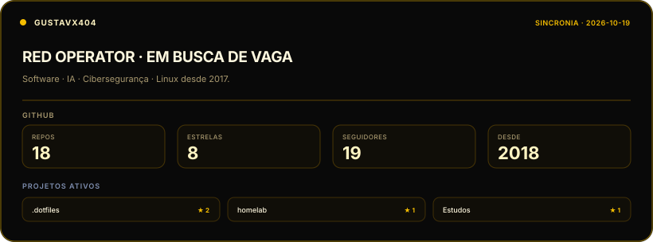
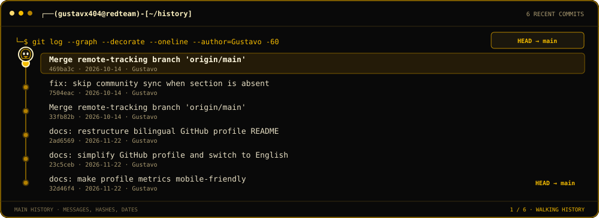

**PT-BR** · [**EN**](README.md)

## `$ whoami`

Sou **Gustavx404**, operador de Red Team e usuário Linux desde 2017. Meus projetos reúnem segurança web, IA, ferramentas para Linux e infraestrutura auto-hospedada. Estou em busca de uma oportunidade em cibersegurança.

## `$ ls ~/projects`

### Segurança e laboratório

| Repositório | O que você encontra |
| --- | --- |
| [ctf-vault](https://github.com/gustavx404/ctf-vault) | Base de conhecimento para prática de CTFs e estudos de segurança ofensiva. |
| [redteam-ai](https://github.com/gustavx404/redteam-ai) | Laboratório local de IA para pesquisa em Red Team. |
| [homelab](https://github.com/gustavx404/homelab) | Infraestrutura auto-hospedada com Docker Compose, Suricata e CrowdSec. |

### Linux e código aberto

| Repositório | O que você encontra |
| --- | --- |
| [backup-omarchy](https://github.com/gustavx404/backup-omarchy) | Backup e sincronização para Omarchy com painel Quickshell, rclone e agendamento via systemd. |
| [yubikey-omarchy](https://github.com/gustavx404/yubikey-omarchy) | Widget Quickshell para códigos TOTP e HOTP de uma YubiKey. |
| [.dotfiles](https://github.com/gustavx404/.dotfiles) | Configurações de CachyOS e Arch para Fish, Kitty, Starship e outras ferramentas com o tema Ayu Dark. |

### Aplicações e hardware

| Repositório | O que você encontra |
| --- | --- |
| [atlas-launcher](https://github.com/gustavx404/atlas-launcher) | Launcher leve e de código aberto, escrito em Java para Android TV 11+ em ARMv7. |
| [video-upload](https://github.com/gustavx404/video-upload) | Aplicação de upload de vídeos com login, feita com FastAPI, Jinja2 e SQLite. |
| [Portao_esp32](https://github.com/gustavx404/Portao_esp32) | Controle de portão com ESP32 e descoberta MQTT no Home Assistant. |

[Ver todos os repositórios públicos ↗](https://github.com/gustavx404?tab=repositories)

## `$ git log --oneline`

